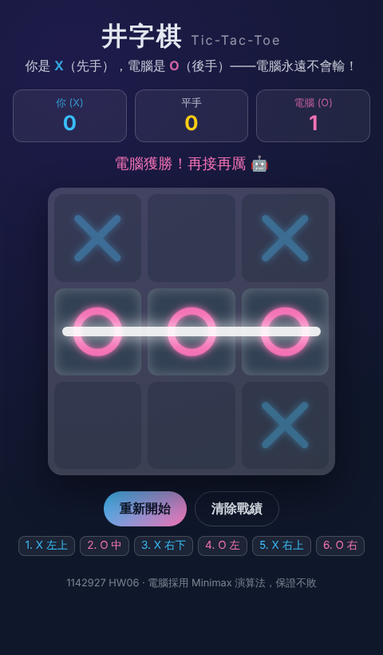

# Ch06 — 井字棋（Tic-Tac-Toe）Web 版｜1142927 HW06

## 一、作業說明
設計一個網頁版井字棋遊戲：
1. 玩家為先手（X），**電腦為後手（O）且不敗**。
2. 加入下棋的動態與變化效果（加分項目）。
3. 程式碼放置於 GitHub。

## 二、執行方式
- 線上遊玩（需先在 GitHub 的 Settings → Pages 啟用，Branch 選擇存放本程式的分支、資料夾 `/ (root)`）：
  `https://xoyoulinox.github.io/Ch06/`
- 本機遊玩：下載後直接用瀏覽器開啟 `index.html` 即可，不需要安裝任何套件。

## 三、檔案結構
| 檔案 | 說明 |
| --- | --- |
| `index.html` | 頁面結構：計分板、狀態列、棋盤、按鈕、下棋紀錄 |
| `style.css` | 版面與所有動畫效果 |
| `script.js` | 遊戲邏輯、電腦 AI（Minimax）、畫面互動 |
| `test/unbeatable.test.js` | 窮舉測試，驗證電腦不敗 |

## 四、電腦不敗的設計（Minimax 演算法）
- 電腦每次下棋前，會把所有可能的後續局面全部模擬一遍（賽局樹搜尋）。
- 計分方式：電腦贏 `+(10 − 步數)`、玩家贏 `−(10 − 步數)`、平手 `0`。
  電腦選分數最高的步，玩家假設會選分數最低的步，所以電腦一定會擋住玩家的所有威脅。
  加入步數權重，電腦會「優先最快獲勝」。
- 使用 **Alpha-Beta 剪枝** 減少不必要的搜尋，回應即時。
- 若有多個同樣好的下法，隨機挑選其一，讓每局棋路有變化，但不影響不敗。

### 驗證
```bash
node test/unbeatable.test.js
```
結果：窮舉玩家所有下法（含電腦不同的同分選擇），共 2805 局，**電腦勝 1884、平手 921、電腦敗 0**。

## 五、動態與變化設計（加分項目）
| 效果 | 說明 |
| --- | --- |
| 棋子筆畫動畫 | X 的兩筆與 O 的圓圈以 SVG `stroke-dashoffset` 一筆一筆「畫」出來，並帶彈跳縮放 |
| 懸停預覽 | 滑鼠移到空格時顯示半透明 X |
| 電腦思考 | 電腦下棋前顯示「電腦思考中...」跳動的點點，並隨機延遲 0.45～0.8 秒 |
| 勝利連線 | 三連線處畫出發光的白線，連線格子閃爍，其餘格子變暗 |
| 平手 / 點錯 | 平手或點擊已有棋子的格子時，棋盤會左右晃動 |
| 玩家獲勝彩帶 | 掉落彩色紙片（理論上不會發生 😄） |
| 計分板 | 記錄勝／平／負，分數變動時彈跳，輪到誰時外框高亮；以 `localStorage` 保存 |
| 下棋紀錄 | 每一步以「1. X 左上」的標籤逐一滑入顯示 |
| 棋盤進場 | 每開一局，棋盤旋轉縮放進場 |
| 無障礙 | 支援鍵盤 Tab 操作與螢幕閱讀器標籤；尊重系統「減少動態效果」設定 |

## 六、畫面截圖


## 七、心得
透過這次作業，我了解如何用 Minimax 演算法讓電腦在井字棋中做出最佳決策：因為井字棋的狀態空間很小，
電腦可以把所有可能的棋局都算完，所以只要演算法正確，後手的電腦就一定不會輸。
另外也練習了用 CSS 動畫與 SVG 讓遊戲的落子、勝負變化更生動。
